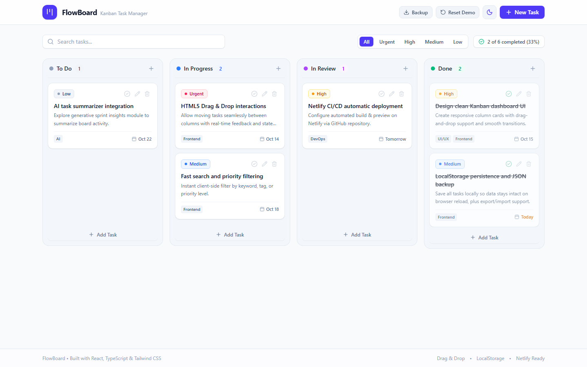
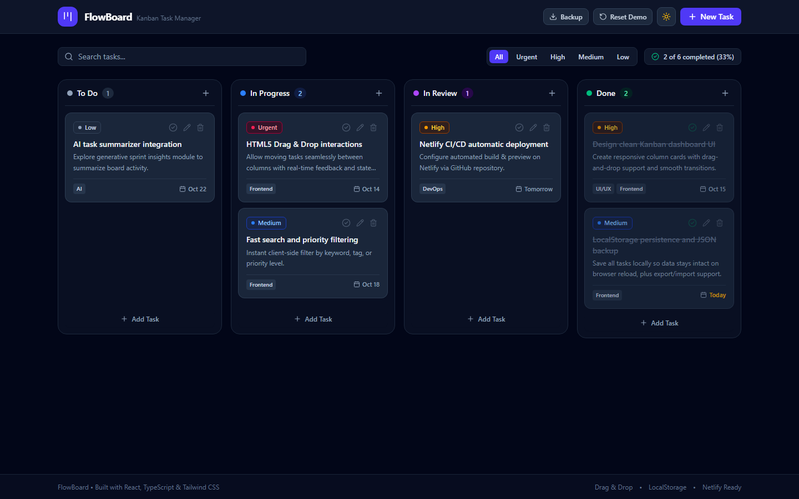

# ⚡ FlowBoard — Minimalist Kanban Task Manager

<div align="center">

| Light Mode | Dark Mode |
| :---: | :---: |
|  |  |

[](https://react.dev/)
[](https://www.typescriptlang.org/)
[](https://tailwindcss.com/)
[](https://vitejs.dev/)
[](https://www.netlify.com/)
[](https://developer.mozilla.org/en-US/docs/Web/API/Window/localStorage)

<br/>

**FlowBoard** is a clean, modern, and responsive Kanban task management application built with **React 19**, **TypeScript**, and **Tailwind CSS**. It features native **HTML5 Drag & Drop**, **LocalStorage persistence**, **instant search & priority filters**, and a seamless **Light / Dark mode** switcher.

[✨ Features](#-key-features) • [📂 Project Structure](#-project-structure) • [🛠️ Quick Start](#️-getting-started) • [🚀 Deploy to Netlify](#-deploy-to-netlify)

</div>

---

## 📋 Project Requirements & Rubric Compliance

This project fulfills all requirements specified in the project guidelines:

| Requirement | Status | Implementation Details |
| :--- | :---: | :--- |
| **Modern JS Library / Framework** | ✅ | **React 19** + **TypeScript** powered by **Vite** |
| **LocalStorage Persistence** | ✅ | Tasks, theme preference, and board states persist in `localStorage` |
| **CSS Framework** | ✅ | **Tailwind CSS v4** (Utility-first, responsive, Dark/Light mode) |
| **Project Directory Tree** | ✅ | Structured in `components/`, `pages/`, `interfaces/`, and `utils/` |
| **1. Create (Add)** | ✅ | Create new task modal with title, description, priority, column, tags & due date |
| **2. Read (List)** | ✅ | 4 clean columns (To Do, In Progress, In Review, Done) with counters & progress |
| **3. Update (Edit & Drag-Drop)**| ✅ | Edit task details modal, quick-toggle completed, and **HTML5 Drag & Drop** column movement |
| **4. Delete (Remove)** | ✅ | Safe task deletion with confirmation dialog (`DeleteConfirmModal`) |
| **Project Screenshot** | ✅ | Real app screenshots in `screenshots/light.png` and `screenshots/dark.png` |
| **GitHub Public Repository** | ✅ | Git initialized with structured commits on `main` branch |
| **Netlify Deployment** | ✅ | `netlify.toml` configured with SPA redirects for instant 1-click deploy |

---

## ✨ Key Features

- **🎯 4 Focused Kanban Columns:** *To Do*, *In Progress*, *In Review*, and *Done*.
- **🖱️ Native HTML5 Drag & Drop:** Effortlessly drag cards across columns with smooth drop feedback.
- **🌓 Light & Dark Mode:** Toggle between sleek dark mode and bright light mode with instantaneous CSS variant switching and saved preferences.
- **🔍 Instant Search & Priority Filter:** Real-time search across task titles/descriptions, plus one-click priority filtering (*Urgent*, *High*, *Medium*, *Low*).
- **💾 JSON Backup & Restore:** Export all board data as a `.json` file or restore previously backed up tasks.
- **⚡ Zero Clutter UI:** Modern minimalist interface inspired by Linear and Notion.

---

## 📂 Project Structure

```text
flowboard/
├── public/
│   └── favicon.svg              # Custom SVG Kanban logo
├── screenshots/
│   ├── light.png                # Light mode screenshot
│   └── dark.png                 # Dark mode screenshot
├── src/
│   ├── components/              # Modular UI components
│   │   ├── Column.tsx           # Column droppable zone
│   │   ├── DeleteConfirmModal.tsx # Delete confirmation modal
│   │   ├── FilterBar.tsx        # Search, priority filters & progress
│   │   ├── Header.tsx           # Brand, theme toggle, new task & backup
│   │   ├── ImportExportModal.tsx# JSON backup / restore modal
│   │   ├── TaskCard.tsx         # Draggable task card
│   │   └── TaskModal.tsx        # Add / Edit task modal
│   ├── interfaces/              # TypeScript types & interfaces
│   │   ├── column.ts            # Column structure
│   │   ├── filter.ts            # Filter & stats interfaces
│   │   └── task.ts              # Task & TaskFormData schemas
│   ├── pages/                   # Application pages
│   │   └── BoardPage.tsx        # Main board layout & CRUD state
│   ├── utils/                   # Helpers and services
│   │   ├── constants.ts         # Columns, priority configs & sample tasks
│   │   ├── date.ts              # Due date formatting & overdue checks
│   │   └── storage.ts           # LocalStorage service & JSON helpers
│   ├── App.tsx                  # Root application component
│   ├── index.css                # Tailwind CSS v4 styling & dark variant
│   └── main.tsx                 # React DOM entry point
├── index.html                   # HTML template
├── netlify.toml                 # Netlify build & redirect rules
├── package.json                 # Dependencies and build scripts
└── vite.config.ts               # Vite configuration
```

---

## 🛠️ Getting Started

### Prerequisites
- Node.js (v18 or higher)
- npm or yarn

### 1. Install dependencies
```bash
npm install
```

### 2. Start development server
```bash
npm run dev
```
Open [http://localhost:5173](http://localhost:5173) in your browser.

### 3. Build for production
```bash
npm run build
```

---

## 🚀 Deploy to Netlify

### Option 1: Automatic Deploy via GitHub (Recommended)
1. Push this repository to your GitHub account:
   ```bash
   git remote add origin https://github.com/YOUR_USERNAME/flowboard.git
   git push -u origin main
   ```
2. Log into [Netlify.com](https://www.netlify.com).
3. Click **"Add new site"** > **"Import an existing project"** and select your `flowboard` repo.
4. Netlify will auto-detect the configuration:
   - **Build command:** `npm run build`
   - **Publish directory:** `dist`
5. Click **"Deploy flowboard"**.

### Option 2: Drag & Drop Deploy
1. Run `npm run build`.
2. Go to [app.netlify.com/drop](https://app.netlify.com/drop) and drag the `dist` folder into the upload box.

---

## 📄 License
MIT License. Open source and free for personal & educational use.
