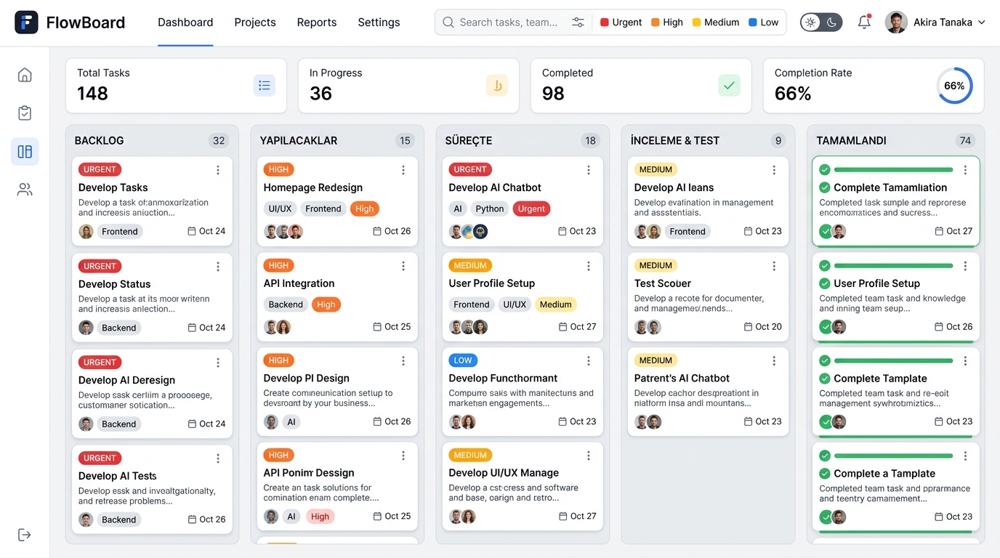

# ⚡ FlowBoard — Modern Kanban & Görev Yönetim Panosu

<div align="center">



[](https://react.dev/)
[](https://www.typescriptlang.org/)
[](https://tailwindcss.com/)
[](https://vitejs.dev/)
[](https://www.netlify.com/)
[](https://developer.mozilla.org/en-US/docs/Web/API/Window/localStorage)

<br/>

**FlowBoard**, modern web teknolojileri (React, TypeScript, Tailwind CSS) ve LocalStorage mimarisi ile geliştirilmiş; sürükle-bırak (Drag & Drop), anlık arama, etiket/öncelik filtreleme ve JSON yedekleme desteğine sahip profesyonel bir Kanban görev ve sprint yönetim panosudur.

[🚀 Canlı Demo](#-canlı-yayın-ve-deployment-netlify) • [✨ Özellikler](#-özellikler) • [📂 Proje Mimarisi](#-proje-klasör-yapısı) • [🛠️ Kurulum](#️-yerel-kurulum-ve-çalıştırma)

</div>

---

## 📌 Proje Gereksinimleri ve Karşılanan Kriterler

Bu proje, **Web Geliştirme; Yapay Zeka Proje Yönergesi** kapsamındaki tüm zorunlu ve tavsiye edilen adımları eksiksiz karşılayacak şekilde hazırlanmıştır:

| Yönerge Kriteri | Durum | Projedeki Karşılığı |
| :--- | :---: | :--- |
| **Modern JS Kütüphanesi** | ✅ | **React (Vite)** + **TypeScript** |
| **LocalStorage Kullanımı** | ✅ | Tüm görevler ve tema tercihi `localStorage` üzerinde saklanır |
| **CSS Framework** | ✅ | **Tailwind CSS** (Responsive, Dark Mode destekli) |
| **Klasör Mimarisi** | ✅ | `components/`, `pages/`, `interfaces/`, `utils/` modüler mimarisi |
| **1. Ekle İşlemi (Create)** | ✅ | Modal üzerinden başlık, açıklama, öncelik, sütun, etiket ve tarih ile yeni görev ekleme |
| **2. Listeleme İşlemi (Read)** | ✅ | 5 ayrı sütunda kart bazlı listeleme, dinamik istatistikler ve sayaçlar |
| **3. Güncelleme İşlemi (Update)** | ✅ | Görev modalı ile düzenleme, tamamlama checkbox'ı ve **HTML5 Drag & Drop** ile sütunlar arası taşıma |
| **4. Silme İşlemi (Delete)** | ✅ | Onay modalı (`DeleteConfirmModal`) ile güvenli görev silme |
| **Ekran Görüntüsü** | ✅ | `screenshots/preview.png` görseli eklendi |
| **GitHub ve Netlify Yayını** | ✅ | `netlify.toml` hazırlandı, Git reposuna aktarılabilir yapı kuruldu |

---

## ✨ Özellikler

### 1. Tam Kapsamlı CRUD Operasyonları
- **Ekle (Create):** Görev başlığı, detaylı açıklama, hedef sütun (Backlog, Yapılacaklar, Süreçte, İnceleme, Tamamlandı), öncelik düzeyi (Düşük, Orta, Yüksek, Kritik), etiketler ve bitiş tarihi.
- **Listele (Read):** Her sütunun durumuna göre dinamik olarak listelenen görev kartları ve sütun sayaçları.
- **Güncelle (Update):**
  - Görev kartı üzerindeki düzenleme butonu ile tüm alanları güncelleme.
  - Kartları fareyle **sürükleyip (Drag & Drop)** başka bir sütuna bırakarak durum güncelleme.
  - Tek tıkla tamamlandı / aktif durumuna alma.
- **Sil (Delete):** Yanlışlıkla silinmeyi önleyen modern onay diyalogu ile güvenli silme.

### 2. Gelişmiş Arama & Çoklu Filtreleme
- **Anlık Metin Arama:** Başlık veya açıklama metinleri içerisinde canlı filtreleme.
- **Öncelik Filtresi:** Tümü, Düşük, Orta, Yüksek ve Acil seviyelerine göre filtreleme.
- **Etiket Filtresi:** Frontend, Backend, UI/UX, Yapay Zeka, Bug vb. etiketlere göre ayrıştırma.
- **Sıralama (Sort):** En yeni, en eski, öncelik düzeyi ve alfabetik sıralama.

### 3. Gerçek Zamanlı Metrikler & İstatistik Barı
- Toplam görev adedi.
- Aktif süreçteki (In Progress) iş sayısı.
- Tamamlanan görev sayısı ve **% cinsinden tamamlanma oranı**.
- Acil / Kritik öncelikli görev sayısı.

### 4. Koyu (Dark) ve Açık (Light) Tema
- Tek tıkla göz yormayan Dark Mode veya aydınlık Light Mode geçişi.
- Seçilen tema kullanıcının cihazında `localStorage` ile hatırlanır.

### 5. Veri Yedekleme (JSON Export / Import)
- Panodaki tüm görevleri tek tıkla `.json` dosyası olarak indirme veya panoya kopyalama.
- Dışarıdan `.json` dosyası yükleyerek veya yapıştırarak verileri geri yükleme.
- İstenildiği an tek tıkla zengin demo verilerine dönebilme.

---

## 📂 Proje Klasör Yapısı

```text
flowboard/
├── public/
│   └── favicon.svg              # Özel SVG Kanban favicon
├── screenshots/
│   └── preview.png              # Proje ekran görüntüsü
├── src/
│   ├── components/              # Yeniden kullanılabilir UI bileşenleri
│   │   ├── Column.tsx           # Kanban sütunu ve Drop Zone
│   │   ├── DeleteConfirmModal.tsx # Silme onay modalı
│   │   ├── FilterBar.tsx        # Arama, filtreleme ve sıralama çubuğu
│   │   ├── Header.tsx           # Üst bar, logo, tema ve butonlar
│   │   ├── ImportExportModal.tsx# JSON yedekleme / yükleme modalı
│   │   ├── StatsOverview.tsx    # İstatistik ve metrik kartları
│   │   ├── TaskCard.tsx         # Sürüklenebilir görev kartı
│   │   └── TaskModal.tsx        # Görev Ekleme ve Güncelleme modalı
│   ├── interfaces/              # TypeScript tip ve arayüz tanımları
│   │   ├── column.ts            # Sütun veri yapısı
│   │   ├── filter.ts            # Filtre ve istatistik tipleri
│   │   └── task.ts              # Görev veri yapısı (Task, TaskFormData, vb.)
│   ├── pages/                   # Sayfa bileşenleri
│   │   └── BoardPage.tsx        # Ana Kanban Pano sayfası ve state yönetimi
│   ├── utils/                   # Yardımcı fonksiyonlar ve servisler
│   │   ├── constants.ts         # Sütunlar, öncelik stilleri ve başlangıç verileri
│   │   ├── date.ts              # Tarih ve gecikme hesaplama yardımcıları
│   │   └── storage.ts           # LocalStorage CRUD ve JSON import/export servisleri
│   ├── App.tsx                  # Ana uygulama sarmalayıcısı
│   ├── index.css                # Tailwind CSS v4 ve özel scrollbar tanımları
│   └── main.tsx                 # React DOM React 19 başlatıcı
├── index.html                   # HTML5 şablonu
├── netlify.toml                 # Netlify build ve SPA redirect ayarları
├── package.json                 # Bağımlılıklar ve npm scriptleri
├── tsconfig.json                # TypeScript yapılandırması
└── vite.config.ts               # Vite & Tailwind eklenti yapılandırması
```

---

## 🛠️ Yerel Kurulum ve Çalıştırma

Projeyi kendi bilgisayarınızda çalıştırmak için aşağıdaki adımları izleyin:

### Gereksinimler
- **Node.js**: v18 veya üzeri (Tavsiye edilen: v20+)
- **npm**, **yarn** veya **pnpm**

### Adım 1: Bağımlılıkları Yükleyin
```bash
npm install
```

### Adım 2: Geliştirme Sunucusunu Başlatın
```bash
npm run dev
```
Terminalde çıkan adrese (genellikle `http://localhost:5173`) tarayıcınızdan gidin.

### Adım 3: Üretim (Production) Derlemesi Alın
```bash
npm run build
```
Bu komut `dist/` klasörü altında optimize edilmiş HTML, CSS ve JS çıktılarını oluşturur.

---

## 🚀 Canlı Yayın ve Deployment (Netlify)

Bu proje Netlify ile %100 uyumludur ve kök dizininde `netlify.toml` dosyası hazır olarak bulunur.

### Yöntem A: GitHub ile Otomatik Dağıtım (Tavsiye Edilen)
1. Bu projeyi GitHub hesabınızda **Public** bir repoya yükleyin (Push edin):
   ```bash
   git init
   git add .
   git commit -m "feat: initial commit - flowboard kanban app"
   git branch -M main
   git remote add origin https://github.com/KULLANICI_ADINIZ/flowboard.git
   git push -u origin main
   ```
2. [Netlify.com](https://www.netlify.com) adresine giriş yapın.
3. **"Add new site"** > **"Import an existing project"** > **GitHub** seçin.
4. `flowboard` reposunu seçin.
5. Ayarlar otomatik algılanacaktır:
   - **Build command:** `npm run build`
   - **Publish directory:** `dist`
6. **"Deploy flowboard"** butonuna tıklayın. Siteniz 30 saniye içinde `https://flowboard-xxxx.netlify.app` olarak canlıya geçecektir!

### Yöntem B: Sürükle & Bırak (Netlify Drop)
1. Bilgisayarınızda `npm run build` komutunu çalıştırın.
2. [app.netlify.com/drop](https://app.netlify.com/drop) adresini açın.
3. Oluşan `dist` klasörünü doğrudan tarayıcı penceresine sürükleyip bırakın. Siteniz anında yayına girer.

---

## 📋 Proje Teslim Kontrol Listesi

- [x] Modern JavaScript kütüphanesi seçildi (React 19 + TypeScript + Vite)
- [x] LocalStorage veri kalıcılığı entegre edildi
- [x] Tailwind CSS ile modern ve duyarlı (responsive) UI tasarlandı
- [x] `Components`, `Pages`, `Interfaces`, `Utils` klasör hiyerarşisi oluşturuldu
- [x] Ekleme (Create) işlemi tamamlandı
- [x] Listeleme (Read) işlemi tamamlandı
- [x] Güncelleme (Update) işlemi (modal ve drag-and-drop) tamamlandı
- [x] Silme (Delete) işlemi tamamlandı
- [x] Proje ekran görüntüsü (`screenshots/preview.png`) eklendi
- [x] Netlify dağıtım ayarları (`netlify.toml`) yapılandırıldı
- [x] Detaylı ve profesyonel `README.md` hazırlandı

---

## 📄 Lisans
Bu proje açık kaynaklıdır ve MIT lisansı altındadır. Eğitim ve portföy amaçlı serbestçe kullanılabilir.
